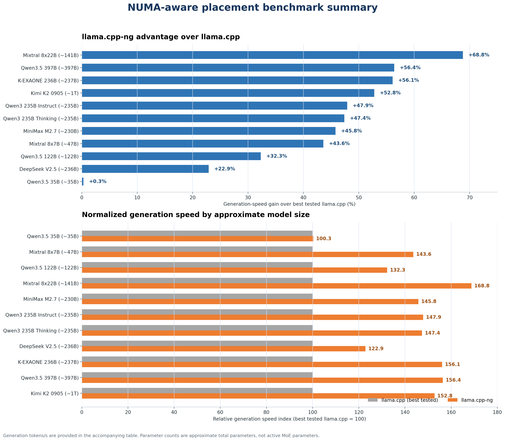
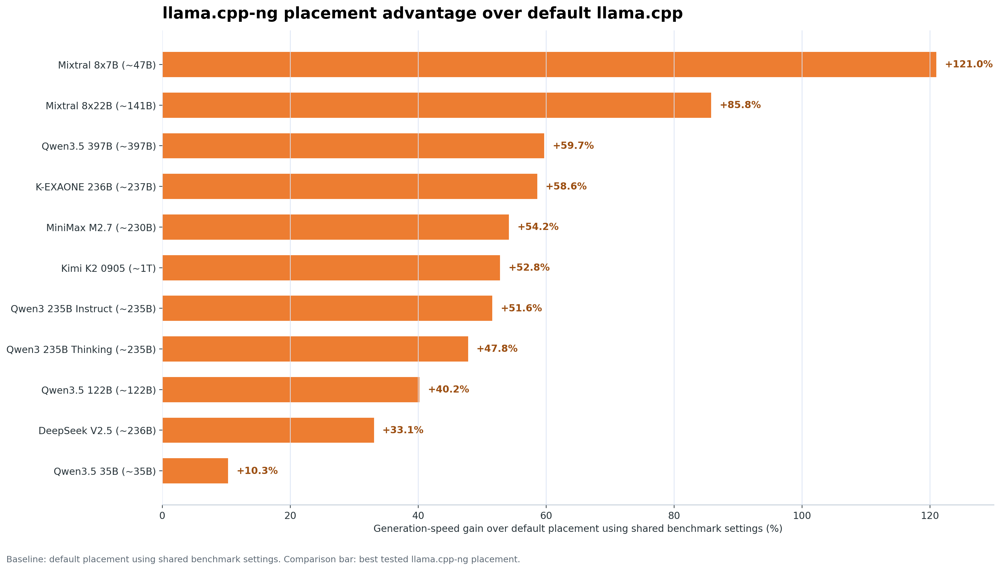

# llama.cpp-ng

## NUMA placement planner benchmark release

**Benchmark report — October 2026**

`llama.cpp-ng` is an experimental fork of `llama.cpp` focused on large GGUF
models running across multiple NUMA nodes and small GPUs. Its placement planner
selects a workable distribution of model weights, CPU Meta tensors, GPU layers,
and selective MoE expert layers for the available hardware.

The most important result is not a universal tokens-per-second number. Absolute
throughput is specific to the model, quantization, hardware, context, and
placement. The useful comparison is the relative speed of the best tested
`llama.cpp-ng` placement against the best tested `llama.cpp` placement for the
same model.





## Results

All values are generation tokens per second. “Best” means the best tested
configuration selected with planner assistance; it does not mean the default
configuration of either implementation.

| Model | Approx. total params | `llama.cpp` default | Best `llama.cpp` | Best `llama.cpp-ng` | Gain vs best `llama.cpp` |
|---|---:|---:|---:|---:|---:|
| Qwen3.5-35B Q4_K_M | ~35B | 23.34 | 25.66 | 25.74 | +0.3% |
| Mixtral 8x7B Q4_K_M | ~47B | 3.75 | 5.77 | 8.29 | +43.6% |
| Qwen3.5-122B Q5_K_M | ~122B | 6.10 | 6.46 | 8.55 | +32.3% |
| Mixtral 8x22B Q4_K_M | ~141B | 1.40 | 1.54 | 2.60 | +68.8% |
| MiniMax-M2.7 UD-Q4_K_M | ~230B | 4.87 | 5.15 | 7.50 | +45.8% |
| Qwen3-235B Instruct UD-Q4_K_XL | ~235B | 2.89 | 2.96 | 4.38 | +47.9% |
| Qwen3-235B Thinking UD-Q4_K_XL | ~235B | 2.96 | 2.97 | 4.38 | +47.4% |
| DeepSeek-V2.5 Q4_K_M | ~236B | 2.81 | 3.04 | 3.73 | +22.9% |
| K-EXAONE-236B Q4_K_M | ~237B | 2.82 | 2.86 | 4.46 | +56.1% |
| Qwen3.5-397B Q6_K | ~397B | 2.62 | 2.67 | 4.18 | +56.4% |
| Kimi K2 0905 Q2_K | ~1T | 2.41 | 2.41 | 3.68 | +52.8% |

The Qwen3.5-35B result is effectively a tie. Across the ten larger models,
`llama.cpp-ng` improves generation speed by 22.9%–68.8%, with a median gain of
approximately 47.7%.

The first graph uses best tested vanilla as its baseline. The second compares
best tested fork placement with vanilla default placement. The table lists both
vanilla baselines; its gain column compares against best tested vanilla.
"Default" refers to placement; shared benchmark settings, including `-t 20`,
were held fixed.

## Benchmark platform

The benchmark server was an older dual-socket Supermicro system:

- **Operating system:** Debian 12
- **CPU:** 2 × Intel Xeon E5-2670 v2 at 2.5 GHz
- **CPU topology:** 20 physical cores total, 40 logical CPUs with SMT
- **Memory:** 384 GB DDR3 ECC RDIMM, running at 1066 MT/s
- **NUMA:** 2 nodes; CPU0/RAM0 and CPU1/RAM1
- **GPUs:** 2 × NVIDIA Tesla P4, 8 GB each
- **GPU architecture:** compute capability 6.1
- **GPU locality:** CUDA0 is local to NUMA node 0; CUDA1 is local to NUMA node 1
- **Reported GPU memory:** approximately 7.43 GiB total and 7.32 GiB free per P4 during planning
- **Model storage:** NFS-backed storage

Measured aggregate host-memory bandwidth was approximately 58.1 GB/s, or about
85% of the theoretical DDR3-1066 bandwidth for this system.

## Build

The published benchmark binary was compiled specifically for this server and
its Tesla P4 GPUs:

```bash
cmake -S . -B build \
  -DCMAKE_BUILD_TYPE=Release \
  -DGGML_CUDA=ON \
  -DGGML_NATIVE=ON \
  -DGGML_LTO=ON \
  -DCMAKE_CUDA_ARCHITECTURES=61 \
  -DLLAMA_BUILD_EXAMPLES=ON

cmake --build build --target llama-cli llama-bench llama-placement -j"$(nproc)"
```

These flags are hardware-specific rather than universal project requirements:

- `CMAKE_CUDA_ARCHITECTURES=61` targets the Tesla P4.
- `GGML_NATIVE=ON` optimizes CPU code for the build host and should be rebuilt
  on a different CPU generation.
- `GGML_LTO=ON` enables link-time optimization for the release build.

Other systems should select the appropriate CUDA architecture and may need a
different CPU-native build.

## Shared benchmark settings

Each benchmark process used the following common settings:

```text
-m MODEL.gguf \
-b 128 -ub 64 -t 20 \
-p 64 -n 32 -r 3 \
-nopo 1 -o json \
--load-mode none -v
```

Additional methodology:

- Warmup was enabled.
- The filesystem/page cache was cleared before each benchmark process.
- Each result used three repetitions.
- Model loading occurred before the timed inference measurements.
  `--load-mode none` selected loading into allocated buffers rather than memory mapping.
- Prompt processing used 64 tokens (`-p 64`).
- Generation used 32 tokens (`-n 32`).
- Batch size was 128 and physical microbatch size was 64.
- The main comparisons used 20 CPU threads. SMT was generally slower for
  generation on this server.
- Results shown here are generation speed; prompt-processing results are not
  included in the summary table.

## Placement configurations

The placement strategy varied by comparison:

| Configuration | Additional options |
|---|---|
| `llama.cpp` CPU | `--numa distribute` or `isolate`, `-dev none`, `-ngl 0`, `--lazy-mode off` |
| `llama.cpp` GPU defaults | `--lazy-mode off`, `--fit-target 1024`, `--fit-ctx 64`; device selection and placement left automatic |
| `llama.cpp` planner placement | Explicit GPU devices, `-sm layer`, `-ts …`, `-ngl …`, `-ncmoe …`, NUMA distribute/isolate, `--lazy-mode off` |
| `llama.cpp-ng` planner | `--numa split`, `-dev CUDA0/CUDA1/CPU0/CPU1`, `-sm layer`, `--layer-split …`, `-ngl …`, `-ncmoe …` |

For the best `llama.cpp-ng` results, the model-specific placement values were
selected by the native planner. The planner may vary the GPU layer split,
number of GPU-resident expert layers, and CPU Meta placement according to the
model architecture, available VRAM, and NUMA topology. Requested context is used
to validate these candidates with llama's allocation simulation; it does not
currently trigger a search for a different placement.

### Using the placement planner

Run the planner with the desired context size and model path. For a split
model, supply all GGUF shards:

```bash
./build/bin/llama-placement -c 2048 /models/my-model/*.gguf
```

The planner detects GPUs and NUMA CPU devices, recommends placement and
generation threads, and estimates memory using llama's allocation logic without
loading the model weights.

The planner output has three main groups.

#### 1. Model and hardware information

This describes what needs placing and where it can go:

- Model size, layers, expert weights, and shared weights.
- GPU memory available.
- NUMA CPU devices and their memory.

These are inputs to the planner, not recommendations.

#### 2. Original placement recommendations

These plans estimate weight memory plus a fixed GPU reserve:

- `plan.aggressive` keeps as much work on the GPUs as the weight budget
  permits.
- `plan.safe` moves one additional layer’s routed expert weights to the CPU,
  leaving more GPU headroom. Its layer distribution otherwise stays the same.
- `plan.primary` is used for dense models or configurations without GPUs,
  where the safe/aggressive MoE pair does not apply.

Each valid plan prints devices, layer shares, CPU expert placement, thread
count, and command fragments. “Safe” does not guarantee that the requested
context fits, because this original calculation does not explicitly size KV
caches and compute buffers.

#### 3. Llama-derived memory validation

`llama.safe`, `llama.aggressive`, or `llama.primary` simulate the corresponding
placement using llama’s runtime sizing logic. For each device, they report:

| Field | Meaning |
|---|---|
| `model_gib` | Weight buffers |
| `cache_state_gib` | KV cache and recurrent state |
| `compute_gib` | Temporary execution buffers |
| `status=fits` | GPU allocations fit with the reserve left available |
| `status=no_fit` | At least one GPU exceeds its budget |

The accompanying `plan.llama_<candidate>` is the same placement with that
validation applied. `valid=1` means it passed; `valid=0` means it should not be
used at those settings.

For ordinary use, choose a valid llama-derived candidate:

```text
plan.llama_<candidate>.valid=1
```

Then copy its `.cli` command and add `-m /path/to/model.gguf`. For split
models, use the first shard for inference.

Optional settings:

| Option | Meaning |
|---|---|
| `-c N` | Context size; default 2048 |
| `-t N` | Generation threads; defaults to the physical core count |
| `-b N` / `-ub N` | Batch and physical microbatch sizes; defaults 128 / 64 |
| `--reserve-mib N` | GPU memory headroom |

The original weight-only plans remain available alongside the llama-validated
set. If no validated candidate fits, reduce the requested context or adjust
the placement; the planner does not silently shrink context. System RAM must
also be sufficient—the current fit decision validates GPU budgets.

Generic `llama.cpp-ng` benchmark form:

```bash
./build/bin/llama-bench \
  -m MODEL.gguf \
  -b 128 -ub 64 -t 20 \
  -p 64 -n 32 -r 3 \
  -nopo 1 -o json \
  --load-mode none -v \
  --numa split \
  -dev CUDA0/CUDA1/CPU0/CPU1 \
  -sm layer \
  --layer-split GPU_LAYER_SPLIT \
  -ngl GPU_LAYERS \
  -ncmoe CPU_MOE_LAYERS
```

`GPU_LAYER_SPLIT`, `GPU_LAYERS`, and `CPU_MOE_LAYERS` are placeholders for
model-specific planner outputs. `-ncmoe` keeps routed expert weights from the
first N layers on CPU; it is not the number of expert layers placed on GPU.
These values are not transferable to every model or hardware configuration.

## Why the result varies by model

The fork’s advantage is largest when a model has substantial CPU-resident work
and the CPU placement is sensitive to NUMA locality. The planner can keep CPU
Meta tensors distributed across both memory controllers while using the P4s
for selected layers or expert layers.

The gain is therefore not a simple function of total parameter count. MoE
routing, expert-layer boundaries, tensor sizes, GPU locality, KV-cache reserve,
and the cost of crossing between CPU and GPU-resident work all affect the best
placement.

Small GPUs can also make a seemingly attractive placement worse: putting only
a small number of expert layers on the GPUs may introduce transfer and
synchronization overhead without providing enough GPU work to compensate.

## Context and VRAM limits

The weight-based planner reserves fixed GPU headroom. Its separate llama-derived
validation adds the requested context's KV cache or recurrent state and compute
buffers to the weight allocations, then checks the remaining GPU budget.

At context 2048, allocation-only checks rejected the existing DeepSeek-V2.5
candidates and the aggressive Qwen3-235B Instruct and Thinking candidates. The
Qwen235 safe candidates fit the reserved budgets. These are simulated memory
checks, not new inference or OOM tests. The planner does not silently reduce
context or automatically search for a replacement when validation fails.

A placement that produces the highest benchmark score but leaves insufficient
VRAM for the intended context is not a useful deployment placement.

## Known limitations

- Absolute throughput numbers should not be generalized to other CPUs, memory
  systems, GPUs, CUDA architectures, or context sizes.
- The benchmark compares vanilla revision `fc07d781e` with fork base
  `431b74ac7` plus local changes. It measures the tested implementations as a
  whole, not the isolated performance contribution of any individual patch.
- This release focuses on layer-mode GPU placement with CPU Meta tensor splitting.
  Preserving CPU Meta placement alongside GPU tensor splitting is deferred.
- Fit status checks GPU budgets. Host/CPU Meta memory is reported, but sufficient
  system RAM must also be available.

## Reproduction checklist

1. Use the same model file and quantization.
2. Build with flags appropriate to the target CPU and GPU architecture.
3. Clear the filesystem/page cache before each process.
4. Enable warmup and run three repetitions.
5. Use the shared benchmark settings above.
6. Use the planner-generated placement for the target model and context.
7. Record both prompt-processing and generation throughput, but compare models
   using relative speed rather than raw tokens/s alone.

## Final release validation

The optimized release build completed, and the CUDA0 ADD correctness check
passed 99 cases. The final Kimi K2 CPU Meta response check completed successfully,
returned the requested two sentences without runaway repetition, and exited
normally. This was a focused correctness check, not a repeat of the benchmark
suite.
